# omp-resume

**The native macOS cockpit for [omp](https://github.com/can1357/oh-my-pi) sessions — browse, inspect, fork and resume, without ever leaving the real CLI.**


-8b949e)

> UI copy ships in Chinese today; this README is English. Screenshots are from the built-in demo backend, so no real session data is shown.

omp stores every session as an append-only JSONL tree under `~/.omp/agent/sessions`. That is a rich, structured record of everything your agent did — and today it is only readable by the CLI, one `--resume` at a time.

omp-resume gives that data a home. It is a Tauri 2 desktop app (React + TypeScript front end, Rust back end) that reads omp's own files directly, renders them as a browsable archive, and hands the session back to the **real `omp --resume` CLI in a new iTerm2 tab** when you want to continue. No reimplementation of the chat UI, no shadow session format, no wrapper around the CLI.

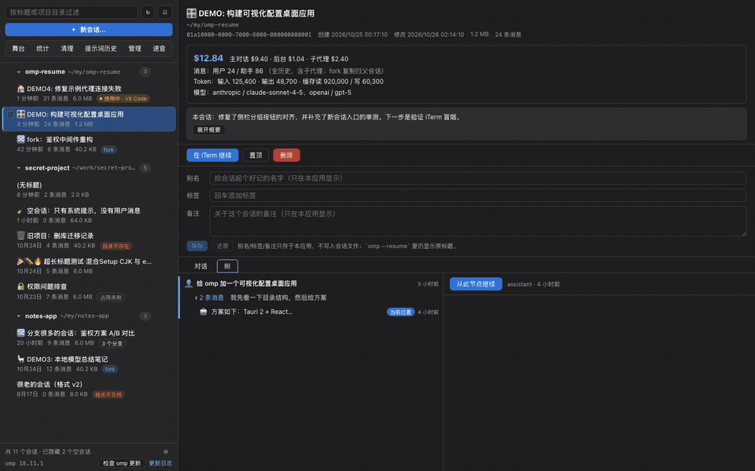

---

## Why this exists

Two kinds of tools already exist: chat clients that host their own runtime, and session archives built for other agents. Neither is an omp-specific macOS app that hands the session back to `omp --resume`.

| Tool | What it is | Where omp-resume differs |
|---|---|---|
| [oh-my-pi-gui](https://github.com/nornzach/oh-my-pi-gui) | Electron GUI with a **bundled agent**: parallel sessions, chat, MCP, skills, plugins, stats | You chat with its runtime. omp-resume hosts no runtime at all — it reads omp's JSONL read-only and resumes the session in the real CLI. |
| [omp-web](https://github.com/17380936778/omp-web) and forks | Browser UI over omp: session browsing + live chat | Same shape, browser-bound: the next turn happens in that app, not in `omp`. |
| [pi-session-manager](https://github.com/Dwsy/pi-session-manager) | Tauri session workbench for Pi and other agents (Claude Code, Codex, OpenCode, Gemini CLI, Cursor) | Broad multi-agent archive; omp is not among its documented sources, and it does not manage omp's config, models, MCP or memory. |
| **omp-resume** | Native macOS inspector + config console + launchpad | Opens the session in a real `omp --resume` iTerm2 tab, and can append a branch marker so that resume continues from any node. |

The design rule is simple: **omp owns the session, omp-resume owns the view.** Writes are limited to app-owned files (`meta.json`, `model-bench.jsonl`, memory backups) and to explicitly confirmed, revision-checked edits of omp's own config files. Session contents are never rewritten.

---

## What you can do

### Browse and resume

- **Sessions grouped by project**, with pinning, multi-select, title/`cwd` filtering and per-session badges (message count, size, in-use state, `format unsupported`).
- **Read-only conversation review** — assistant text, thinking blocks, tool calls, tool results, bash executions, usage, model changes, compaction boundaries. Nothing is replayed into a model.
- **Conversation tree view** — the append-only parent/child graph, rendered as branches. Every node is inspectable.
- **Resume in iTerm2** — opens a new tab and runs the real `omp --resume`. Never sends keystrokes after that.
- **Fork from any node** — appends a branch marker so `--resume` continues from that point, then hands you the CLI.
- **New session in any directory** — with a directory picker, launched in iTerm2.
- **Permanent delete with an in-use guard** — flock-probed first; a session that omp currently holds is never deleted silently.
- **Aliases, tags and notes** — stored in the app's own `meta.json`, never in the session file.

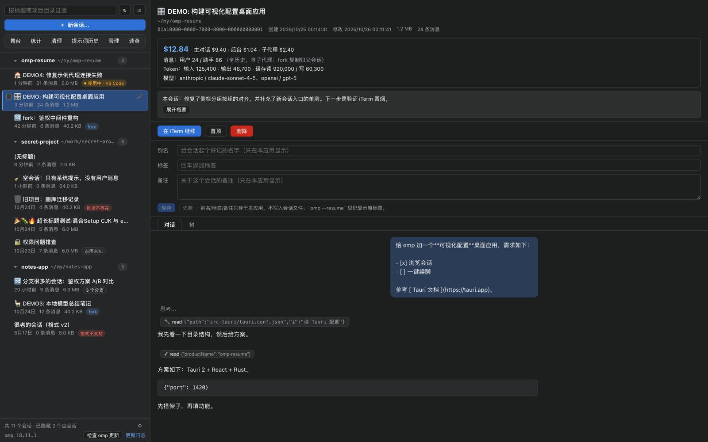
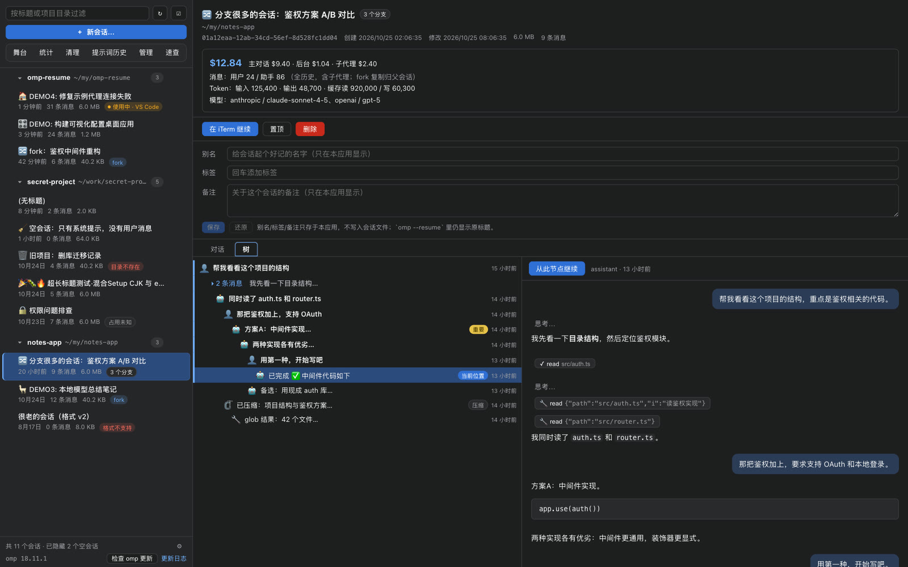

### Insight

- **Usage dashboard** — cost, tokens, cache hit rate, tool time, per-project and per-model composition, heatmap, top sessions, trend lines over today / 24h / 7d / 30d / all time. Every number is derived from `usage` records already present in the JSONL.
- **Runtime health board** — requests, errors and error types, fallback switches with destinations, cache-hit trend and per-model hit rate, plus the recent error log. A flaky upstream is visible without grepping transcripts.
- **Cleanup candidates** — sessions that are empty, whose `cwd` no longer exists, that are unusually large or stale. Read-only scan; deletion still goes through the guarded delete path.
- **Prompt history** — the prompt archive from omp's `history.db`, searchable, with jump-back-to-session.

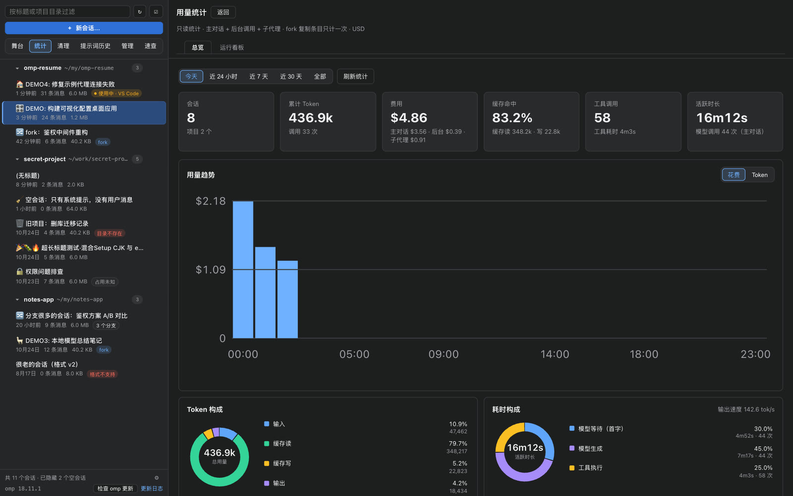
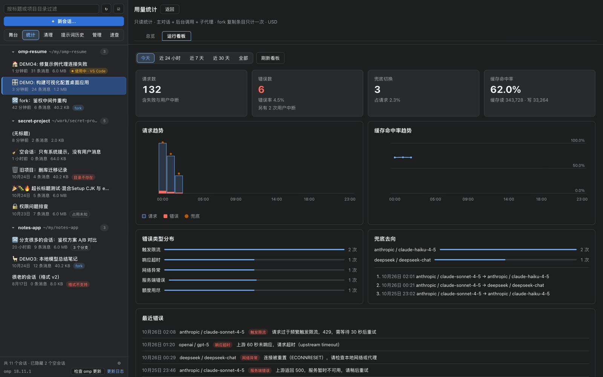
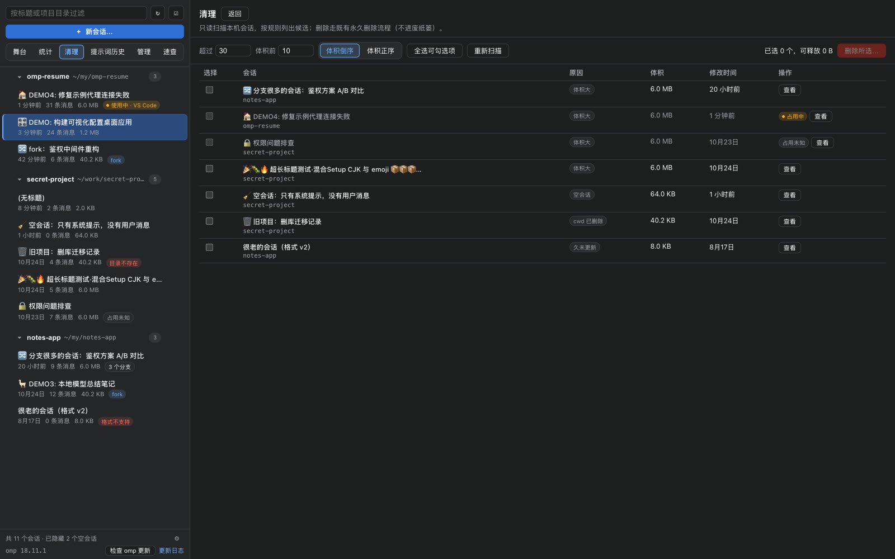
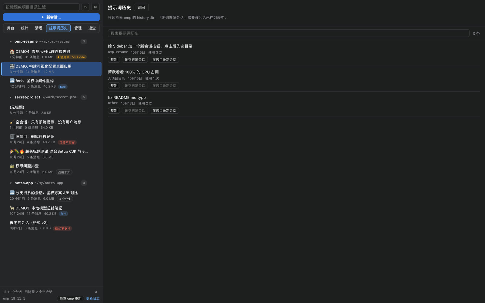

### Agent Stage

A session's sub-agents — `task` sub-agents, `vibe_spawn` workers, the advisor — reconstructed as **a pixel office**. Each actor gets a character, a state (`running` / `idle` / `queued` / `done` / `failed` / `lost`), a live activity feed, token and cost counters, and a timeline. The layout is derived from the JSONL alone: spawn records, lifecycle events, tool executions and message tails.

Nothing here is synthetic. If omp did not record it, the stage does not draw it — including the honest gaps: background bash jobs and omp-internal queues are not in the session file.

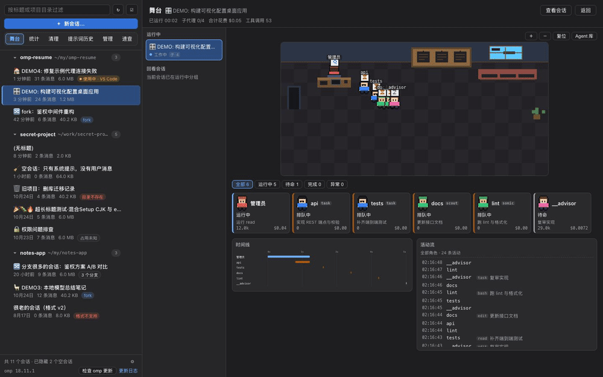

### Environment and configuration

Six tabs, all editing what omp actually reads:

| Tab | What it manages |
|---|---|
| **Models** | The model library from `models.yml` + agent config; context window, max output, reasoning, input types, pricing |
| **Agents** | Agent definitions and their model roles (`modelRoles`) |
| **Plugins** | Marketplace plugins: install, enable/disable, upgrade, marketplace add/remove |
| **Skills** | Installed skills with an update check |
| **MCP** | Native MCP server config for user and project scope, with revision-checked writes |
| **Memory** | Mnemopi long-term memory banks: counts, coverage bars, recall graph, backups, maintenance |

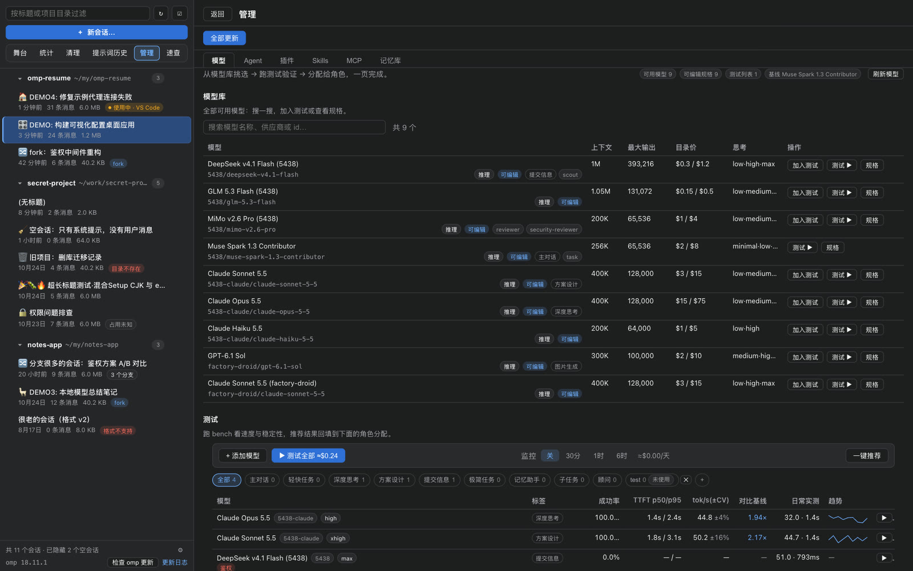
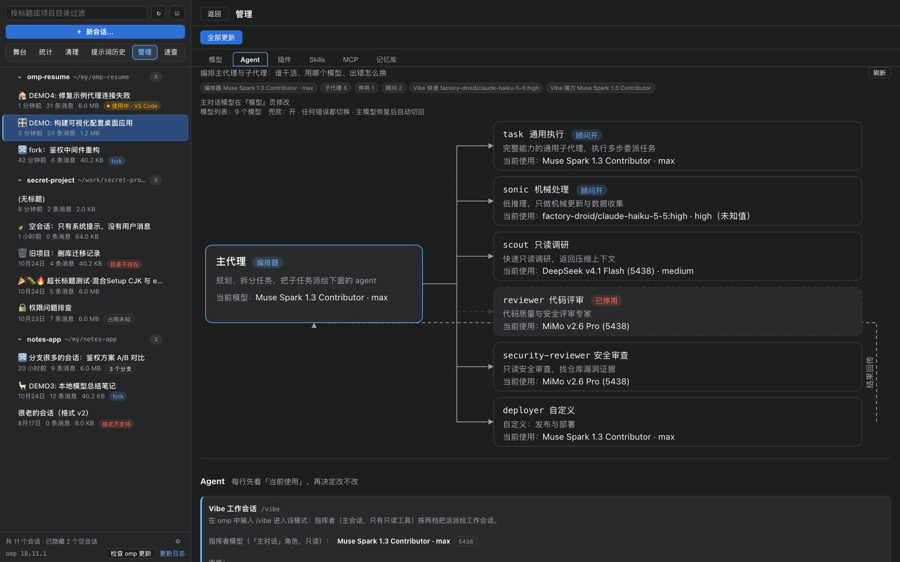
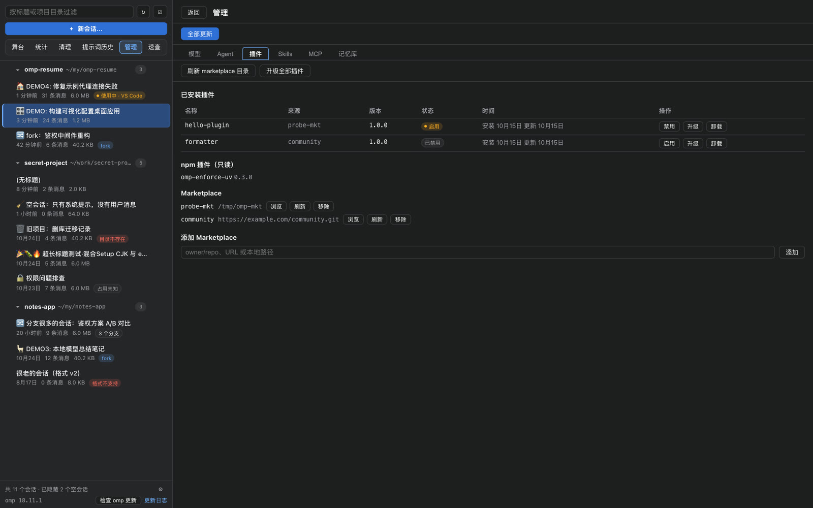
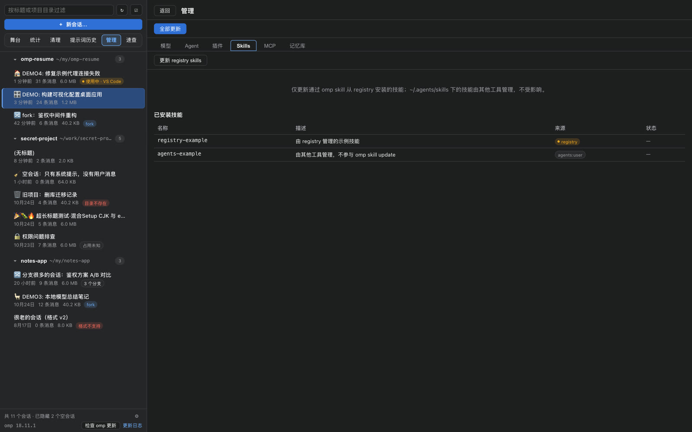
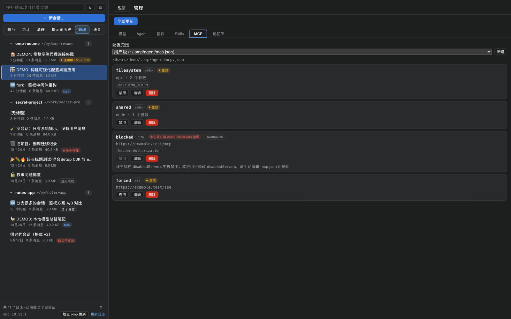
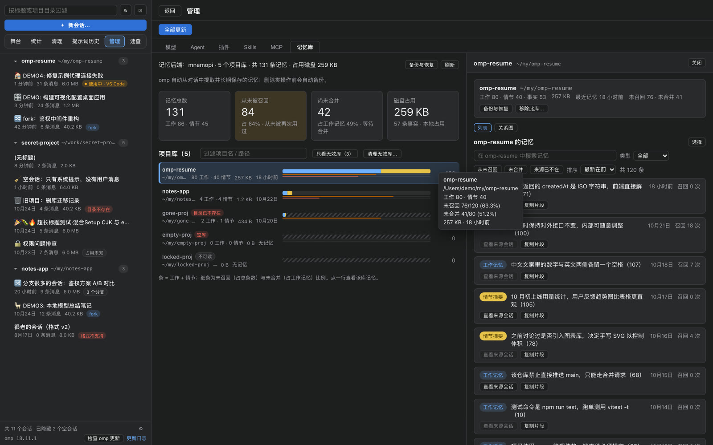

### Model tooling

The **tester** runs `omp bench` against a model selector — a 5×100-token latency probe and a 3×600-token throughput probe with `--par 1` so the numbers are not polluted by concurrency — then computes TTFT p50/p95, tok/s with its coefficient of variation, cost, and a composite score. Results persist to `model-bench.jsonl` for 30 days and can be written straight back into a model role. This is the only code path in the entire app that calls an LLM, and it goes through omp's own benchmark command.

Model **specs** are editable row by row in `models.yml`, with value-shape validation on write and per-row conflict detection.

### Cheat sheet

A searchable reference pinned to **omp 18.12.6**: 87 built-in slash commands with aliases, argument hints and examples, 3 bundled extension commands, 51 terminal subcommands, plus curated learning paths and multi-step recipes. If your installed omp differs, the dialog says so.

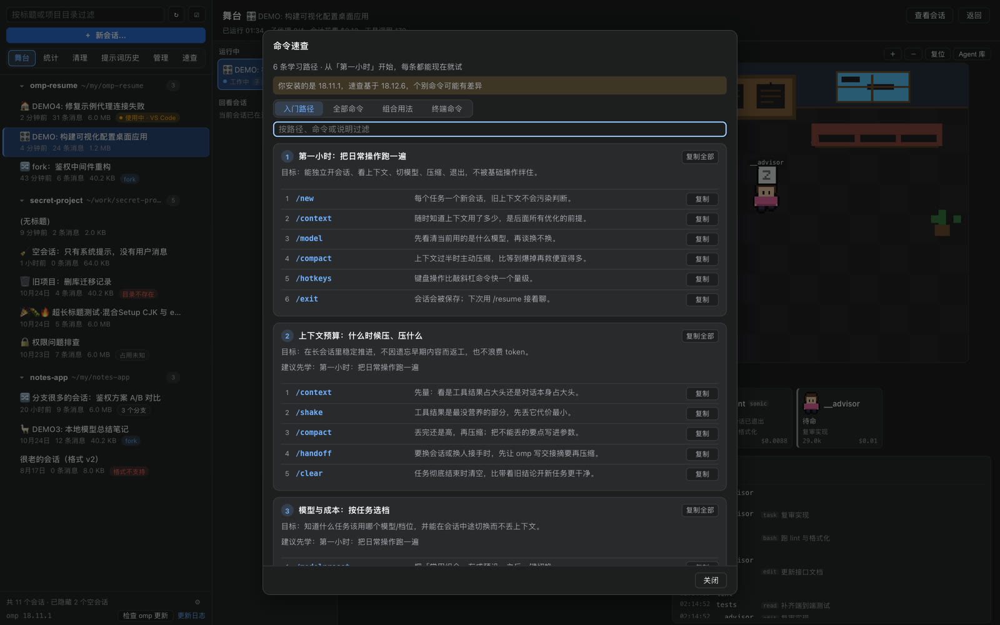

### Menu bar

The tray icon watches **sessions that are running right now** — determined from flock ownership plus the JSONL tail, never from mtime — and classifies them as `working` / `waiting for input` / `idle` / `possibly stuck`. It shows a compact badge (`2·1`), can notify you when a session starts waiting for input, and can focus the owning iTerm2 tab.

The tray itself never kills, signals or types into anything; its only iTerm2 capability is `activate` + `select`.

### Appearance

System / light / dark theme, six accent colors, all stored locally. Both themes are first-class — the screenshots above are dark by choice, not by necessity.

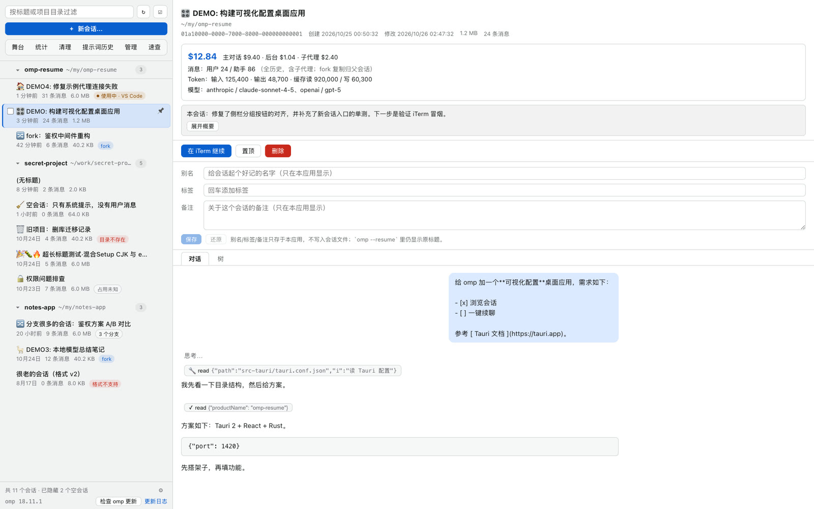

---

## Install

### Prebuilt

Download the latest DMG from [Releases](https://github.com/cjcj5438/omp-resume/releases/latest):

```sh
# omp-resume_0.2.3_aarch64.dmg — macOS arm64
```

The bundle carries no Developer ID and is not notarized. If Gatekeeper blocks it: **right-click → Open** in Applications, once.

The app checks for updates on launch (Tauri updater, minisign-verified) and installs in place.

### From source

Requirements: macOS (arm64), Rust stable via `rustup`, Node.js 22, Xcode Command Line Tools.

```sh
npm install
npm run tauri build
cp -R src-tauri/target/release/bundle/macos/omp-resume.app /Applications
```

The first time you use **Resume in iTerm2**, macOS asks whether omp-resume may control iTerm2. If you decline, the action fails with `ITERM_FAILED`; re-enable it in **System Settings → Privacy & Security → Automation**.

---

## Development

```sh
npm run dev          # front end only; add ?mock to the URL for the demo backend
npm run tauri dev    # full desktop app
npm run check        # typecheck + vitest
cd src-tauri && cargo fmt --check && cargo clippy --all-targets -- -D warnings && cargo test
```

The mock backend is a dev-only import that simulates all 59 IPC commands with stateful fixtures — including failures (`?fail=<command>`), conflicts (`?conflict=<command>`), latency (`?latency=<ms>`) and stage scenarios (`?stage=live|review|many|empty`). CI greps the production bundle to prove the mock never ships.

### Release

The version must agree in three places (`package.json`, `src-tauri/tauri.conf.json`, `src-tauri/Cargo.toml`) and match the tag:

```sh
node scripts/check-versions.mjs
git tag v0.2.3 && git push origin v0.2.3
```

Pushing a `v*` tag runs [.github/workflows/release.yml](.github/workflows/release.yml), which builds the macOS arm64 bundle and creates a **draft** release with updater artifacts. Publish it manually after verifying the assets — `/latest` only resolves to published releases.

The updater signing key lives in the `TAURI_SIGNING_PRIVATE_KEY` CI secret and has no passphrase. **If that private key is lost, already-installed copies can never be updated again.**

---

## How it works

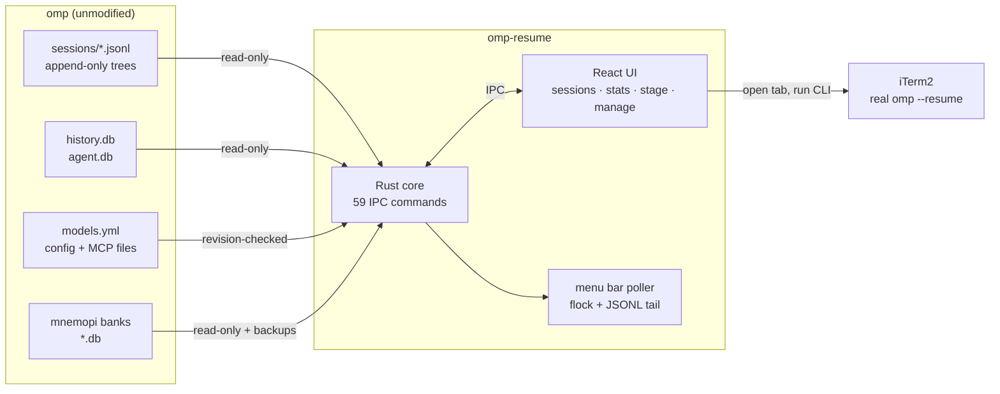

- **Sessions are never rewritten.** The only session-file mutation is a single `custom` line appended for a branch marker, which omp's context builder ignores by design.
- **In-use detection is a real `flock` probe** on omp's ownership lock, not a heuristic.
- **Config writes are validated** against a whitelist, use atomic temp-file + rename, and carry a revision so a concurrent edit surfaces as a conflict instead of being clobbered.
- **Memory deletion always backs up first.**
- Everything is local. No telemetry and no analytics; the only network calls are the updater, `omp update`, `omp bench`, and the plugin/marketplace operations you explicitly trigger.

### Repo layout

```
src/                 React front end (53 test files, 553 tests)
src/stage/           Agent Stage: sprites, layout, scene, timeline
src/components/      Views: sessions, stats, cleanup, history, manage tabs
src-tauri/src/       Rust core (409 tests)
  sessions/          JSONL scan, tree building, conversation parsing
  stage/             Incremental cursors + actor state machine
  usage/             Cost/token aggregation, redaction, caching
  memory/            Mnemopi bank reader
  menubar/           Tray poller, classifier, notifications
  ops/               Delete, iTerm2, branch markers
docs/CONTRACT.md     Authoritative spec: formats, commands, semantics, error codes
docs/DECISIONS.md    Measured evidence behind every non-obvious choice
```

`docs/CONTRACT.md` is the source of truth: for any command, the contract, `model.rs`, `types.ts` and `api.ts` must agree, and the contract wins.

### Configuration

Everything is resolved from omp's own defaults; every path can be overridden for testing or for a non-standard omp install.

| What | Default | Override |
|---|---|---|
| Session directory | `~/.omp/agent/sessions` | `--sessions-dir <path>` or `OMP_RESUME_SESSIONS_DIR` |
| omp binary | first of `$HOME/.local/bin/omp`, `/opt/homebrew/bin/omp`, `/usr/local/bin/omp`, `$HOME/.bun/bin/omp` | `OMP_RESUME_OMP_BIN` |
| Ownership locks | `~/.omp/run/session-owners` | `OMP_RESUME_OWNERS_DIR` |
| Prompt history | `~/.omp/agent/history.db` | `OMP_RESUME_HISTORY_DB` |
| Memory banks | `~/.omp/agent/memories/mnemopi/banks` | `OMP_RESUME_MEMORY_DIR` |
| App data (`meta.json`, `settings.json`, bench records, backups) | `~/Library/Application Support/omp-resume` | `OMP_RESUME_DATA_DIR` |

---

## Known limitations

- **macOS only.** The tray integration, iTerm2 automation and flock semantics are all macOS-specific.
- **Session format version 3 only.** Older sessions are listed but marked as unsupported.
- **Deletion is permanent** — no trash, no undo.
- **The Agent Stage polls** the JSONL every 1.5 s rather than subscribing to events, so it lags reality by up to ~2 s and cannot show background bash jobs or omp-internal queues.
- **Pins and appearance prefs live in WebView localStorage**, so the dev build and the `.app` do not share them.
- Detailed edge cases live in [docs/CONTRACT.md](docs/CONTRACT.md) and [docs/DECISIONS.md](docs/DECISIONS.md).
