# omp-resume

**The native macOS cockpit for [omp](https://github.com/can1357/oh-my-pi) sessions — browse, inspect, fork and resume, without ever leaving the real CLI.**


-8b949e)

> UI copy ships in Chinese today; this README is English. Screenshots are from the built-in demo backend, so no real session data is shown.

omp stores every session as an append-only JSONL tree under `~/.omp/agent/sessions`. That is a rich, structured record of everything your agent did — and today it is only readable by the CLI, one `--resume` at a time.

omp-resume gives that data a home. It is a Tauri 2 desktop app (React + TypeScript front end, Rust back end) that reads omp's own files directly, renders them as a browsable archive, and hands the session back to the **real `omp --resume` CLI in a new iTerm2 tab** when you want to continue. No reimplementation of the chat UI, no shadow session format, no wrapper around the CLI.

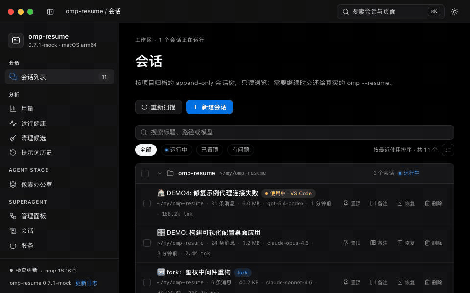

---

## Why this exists

Two kinds of tools already exist: chat clients that host their own runtime, and session archives built for other agents. Neither is an omp-specific macOS app that hands the session back to `omp --resume`.

| Tool | What it is | Where omp-resume differs |
|---|---|---|
| [oh-my-pi-gui](https://github.com/nornzach/oh-my-pi-gui) | Electron desktop GUI with a **bundled agent**: parallel sessions, chat, MCP, skills, plugins, stats — its DMG/NSIS/portable packages need no separate omp install | You chat with its runtime. omp-resume hosts no runtime at all — it reads omp's JSONL read-only and resumes the session in the real CLI. |
| [omp-web](https://github.com/17380936778/omp-web) | Browser UI over omp: session browsing + real-time chat over a local Next.js server | Same shape, browser-bound: the next turn happens in that app, not in `omp`. |
| [pi-session-manager](https://github.com/Dwsy/pi-session-manager) | Tauri session workbench for Pi and other agents (Claude Code, Codex, OpenCode, Gemini CLI, Cursor, Antigravity) | Broad multi-agent archive; omp is not among its documented sources, and it does not manage omp's config, models, MCP or memory. |
| **omp-resume** | Native macOS inspector + config console + agent orchestrator | Opens the session in a real `omp --resume` iTerm2 tab, can append a branch marker so that resume continues from a chosen node, and can run a self-hosted Superagent daemon that works GitHub/Feishu tickets through real omp sessions. |

The design rule is simple: **omp owns the session, omp-resume owns the view.** Writes are limited to app-owned files (`meta.json`, `model-bench.jsonl`, memory backups) and to explicitly confirmed, revision-checked edits of omp's own config files. Session contents are never rewritten.

---

## The shell

The main window is a page-based shell: a left sidebar groups every feature into **会话** (sessions), **分析** (cleanup / prompt history), **Agent Stage** (pixel office), **Superagent** (management panel / sessions / service), **环境配置** (models / agents / plugins / skills / MCP / memory), **工具** (model tester / cheat sheet) and **设置** (appearance & behavior / menu bar). Each session opens a **workspace** with three tabs — 概览 (overview), 对话 (conversation) and 树 (tree).

Global keys: **⌘K** command palette (search sessions, pages and actions), **⌘B** collapse the sidebar, **⌘N** new session, **⌘,** settings. The sidebar footer shows the update state (checking / new version / failed / up to date / idle) with the session count badge on the Sessions entry. The titlebar keeps the native macOS traffic lights (`trafficLightPosition` in `tauri.conf.json`).

---

## What you can do

### Browse and resume

- **Sessions grouped by project**, with pinning, multi-select, title/`cwd`/first-message filtering and per-session badges (message count, size, in-use state, unsupported-format marker).
- **Collapse or expand every visible project** from the session list or workspace rail. By default, only projects with a running session are open; filters open matching projects without changing the unfiltered view.
- **Read-only conversation review** — assistant text, thinking blocks, tool calls, tool results, bash executions, usage, compaction boundaries. Nothing is replayed into a model.
- **Conversation tree view** — the append-only parent/child graph, rendered as branches. Every node is inspectable.
- **Resume in iTerm2** — opens a new tab and runs the real `omp --resume`. Success is only reported after the app observes an `omp --resume` process (or the session lease) attached to *that* new tab's tty, within 10 s; otherwise you get an error with the exact command and that tab's output, the tab stays open and nothing is retyped. After the command is typed once, no further keystrokes are sent.
- **Fork from a chosen node** — appends a branch marker so `--resume` continues from that point, then hands you the CLI. Unavailable on the leaf node itself, on in-use sessions, and where the `cwd` is missing or the format unsupported.
- **New session in any directory** — with a directory picker and model selector, launched in iTerm2.
- **Permanent delete with an in-use guard** — flock-probed first; a session that omp currently holds is never deleted silently.
- **Aliases, tags and notes** — stored in the app's own `meta.json`, never in the session file.

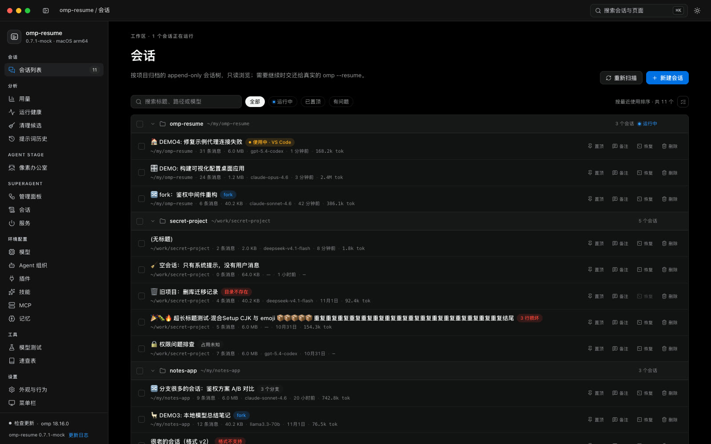
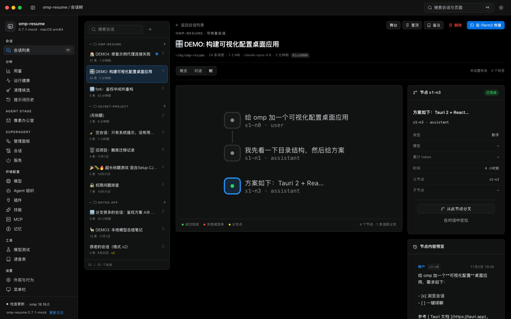

### Cleanup and history

- **Cleanup candidates** — sessions that are empty, whose `cwd` no longer exists, that are unusually large (≥ 5 MiB) or stale. Read-only scan; deletion still goes through the guarded delete path.
- **Prompt history** — the prompt archive from omp's `history.db`, searchable, with jump-back-to-session.

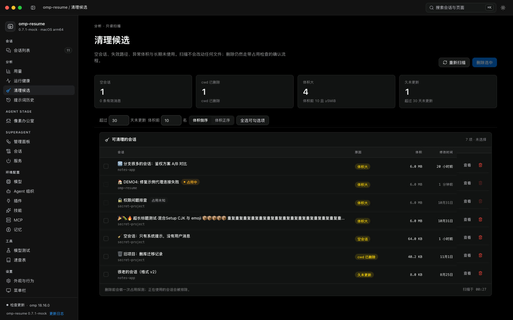
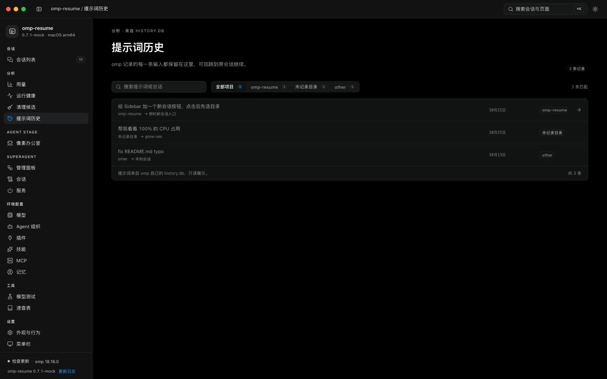

### Agent Stage

A session's sub-agents — `task` sub-agents, `vibe_spawn` workers, the advisor — reconstructed as **a pixel office**. Each actor gets a character, a state (`queued` / `running` / `idle` / `done` / `failed` / `lost`), a live activity feed, token and cost counters, and a timeline. The layout is derived from the JSONL alone: spawn records, lifecycle events, tool executions and message tails.

If omp did not record it, the stage does not draw it — including the honest gaps: background bash jobs and omp-internal queues are not in the session file.

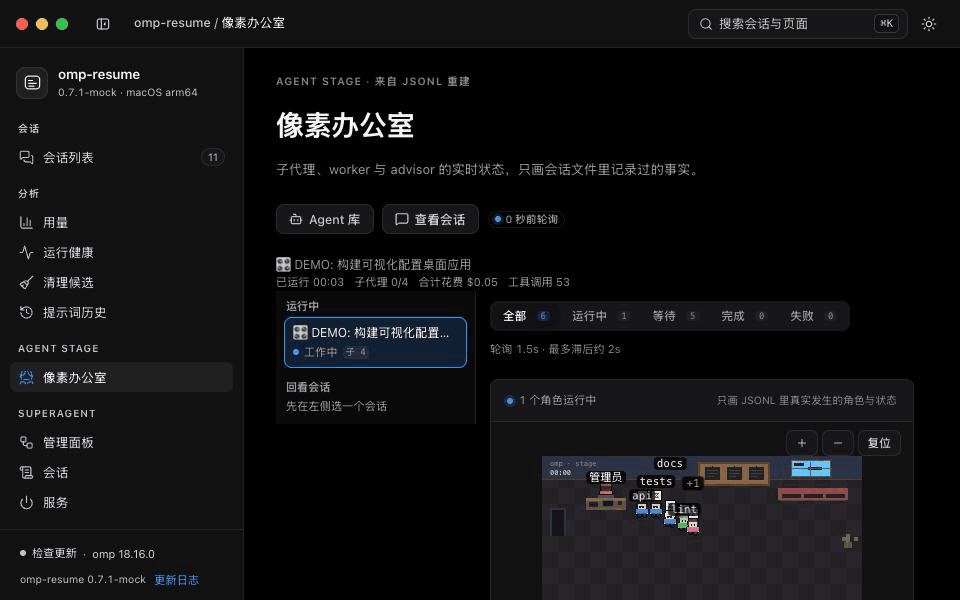

### Superagent

A self-hosted agent orchestrator that lives inside omp-resume (new in 0.7.0). The app spawns and supervises a daemon (`omp run …/dist/daemon.js --state-dir … --socket … --omp …`), which watches GitHub and Feishu sources, evaluates incoming events, authorizes work as tickets, runs one `omp --mode rpc` session per ticket inside an isolated working directory, and reports back to the source. The daemon's own prompt pack, plugin template, and GitHub/Feishu skill manuals ship inside the app bundle.

Three pages under the **Superagent** sidebar group:

| Page | What it does |
|---|---|
| **Management panel** | The daemon's own six-tab UI (overview / source / trigger / eval / execution / settings), embedded via the `omp-superagent/panel` export and themed through CSS token mapping |
| **Sessions** | The orchestrator session plus each worker session, read-only conversation review |
| **Service** | Enable/disable, restart, pid/uptime/restarts, resolved paths, daemon log tail |

The daemon keeps its state under `<data_dir>/superagent` (sqlite store, session JSONL, work directories, prompts, generated plugin dir); dev builds (`npm run tauri dev`) keep a separate `<data_dir>/superagent-dev` seeded once from the production database. The supervisor tracks seven states (`disabled` / `starting` / `running` / `stopping` / `stopped` / `crashed` / `incompatible`), probes readiness over the unix socket, restarts crashed daemons on backoff, and reclaims orphaned daemons left by a previous run. A state-schema mismatch is reported with the exact versions and a one-click 「改用新状态目录」 instead of a crash loop. See `docs/CONTRACT.md` §26 for the hosting state machine, the six IPC commands (`superagent_status` / `superagent_set_enabled` / `superagent_restart` / `superagent_request` / `superagent_log_tail` / `superagent_reset_state`) and the daemon HTTP API.

### Supervisor restart policy

The supervisor never leaves a dead daemon alone: a crash is restarted with the `[1,2,5,10,30,60]`-second backoff, and a `kill -9` is repaired twice over — the stale `daemon.pid` is cleared and the daemon restarted, and if the state-directory lock (`proper-lockfile`, `stale` 30 s) is still held by the dead process, the supervisor retries on `[2,5,10,15,30,60,60,60,60,60]` seconds until the lock expires (≈32 s worst case) or the budget runs out. A foreign daemon that answers on the socket is never fought over: the supervisor only probes it every 60 s and takes over once it disappears. The **Service** page's *Restart* button resets that budget.

Outside this app a second, independent layer lives at `~/my/omp-superagent-watchdog/` (`omp-superagent status|start|stop|restart|doctor|watch` + a LaunchAgent): it runs `GET /orchestrator/api/state` on the daemon socket every 30 s and relaunches either the app or the daemon directly when nothing answers, so a force-quit or a wedged supervisor still ends with a live service.

### Environment and configuration

Six pages, all editing what omp actually reads:

| Page | What it manages |
|---|---|
| **Models** | The model library from `models.yml` + agent config; context window, max output, reasoning, input types, pricing |
| **Agents** | Agent definitions and their model roles (`modelRoles`) |
| **Plugins** | Marketplace plugins: install, enable/disable, upgrade, marketplace add/remove |
| **Skills** | Installed skills with bulk registry update (`omp skill update -g`; per-skill update checks are not offered) |
| **MCP** | Native MCP server config for user and project scope, with revision-checked writes and a connection handshake probe |
| **Memory** | Mnemopi long-term memory banks: counts, coverage bars, recall graph, backups, maintenance |

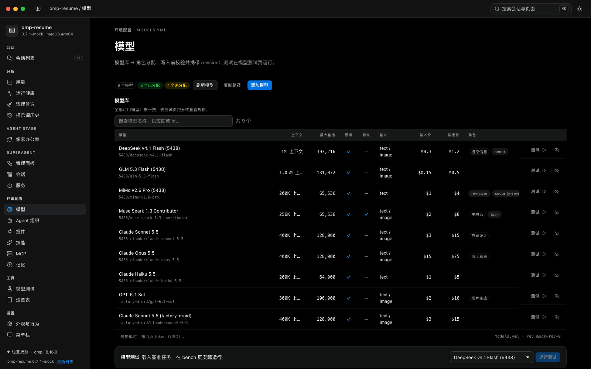
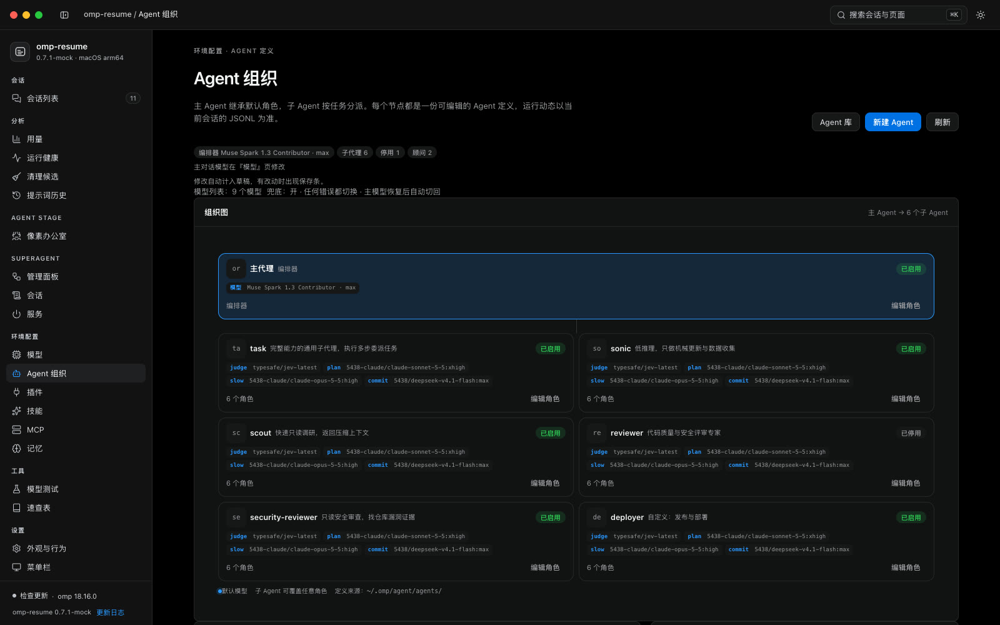
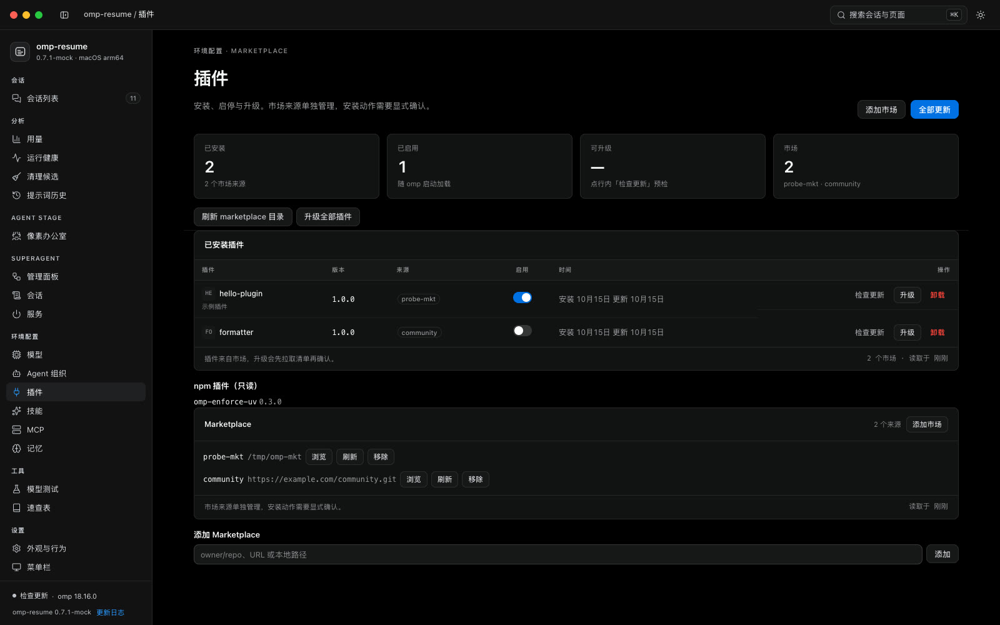
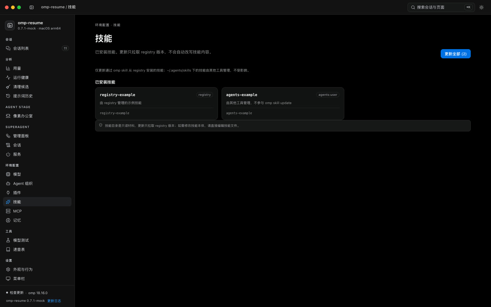
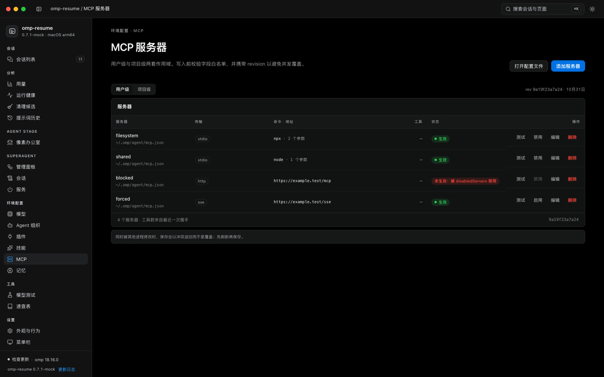
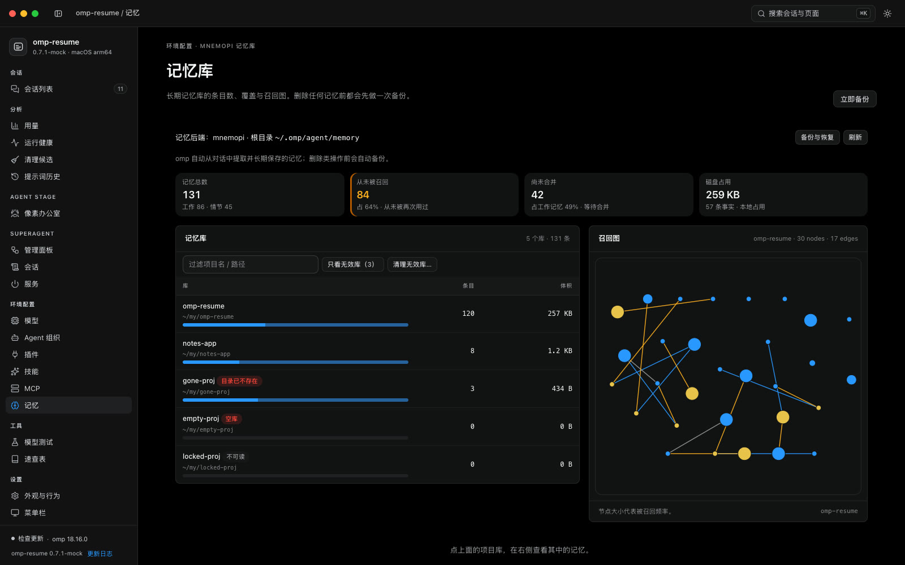

### Model tooling

The **tester** runs `omp bench` against a model selector — a 5×100-token latency probe and a 3×600-token throughput probe with `--par 1` so the numbers are not polluted by concurrency — then computes TTFT p50/p95, tok/s with its coefficient of variation, cost, and a composite score. Results persist to `model-bench.jsonl` for 30 days and can fill a model-role draft straight from the results drawer. This is the only code path in the entire app that calls an LLM, and it goes through omp's own benchmark command.

Model **specs** are editable row by row in `models.yml`, with value-shape validation on write and per-row conflict detection.

### Cheat sheet

A searchable reference pinned to **omp 19.1.1** (see [Command manual](#command-manual) for how it is verified): 92 slash commands (89 built-in and 3 bundled extensions), 54 terminal subcommands, 6 learning paths, and 12 multi-step recipes. `/skill:*` and local custom commands are intentionally unlisted. The page warns when the installed omp version differs.

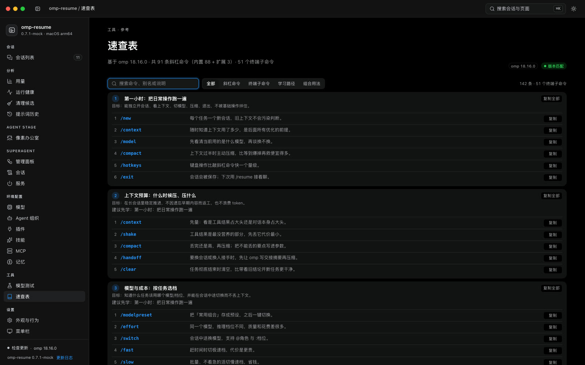

### Menu bar

The tray icon watches **sessions that are running right now** — determined from flock ownership plus the JSONL tail, never from mtime — and classifies them as working / waiting for input / idle / possibly stuck. It shows a compact badge (`2·1`), can notify you when a session starts waiting for input, and can focus the owning iTerm2 tab.

Left-click opens a real **panel window** (`tray-panel`): running sessions with native macOS status dots, search, a "new session" CTA, recent sessions and a mode switcher inline, plus a version row with quit. The panel hides on blur and toggles on repeat clicks (with a 250 ms blur/toggle race guard). Right-click opens the native menu instead (new/recent sessions, settings, quit), and the click behavior (panel vs main window) is configurable in the Menu Bar settings page. Session rows only focus the owning tab (`activate` + `select`); the new/recent entries open a new iTerm2 tab and run the command there via the same primitive as the main window (`ops::iterm::open_tab`). The tray never kills or signals processes, and never types into an existing tab.

### Appearance

System / light / dark theme, six accent colors, all stored locally. The dark theme uses a translucent macOS sidebar material; the light theme keeps the sidebar solid.

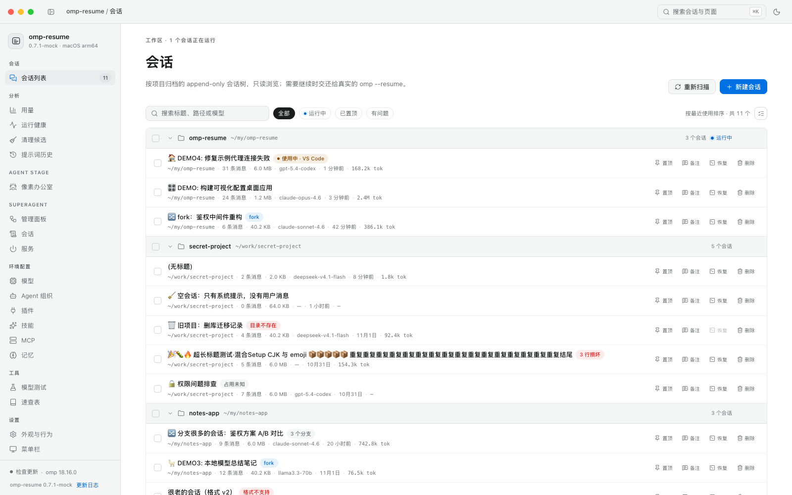

---

## Install

### Prebuilt

Download the latest DMG from [Releases](https://github.com/cjcj5438/omp-resume/releases/latest):

```sh
# omp-resume_0.9.2_aarch64.dmg — macOS arm64
```

The bundle is ad-hoc signed (no Developer ID, not notarized), so a browser-downloaded copy is quarantined and Gatekeeper blocks the first launch. Either open **System Settings → Privacy & Security → Open Anyway**, or clear the quarantine flag once:

```sh
xattr -dr com.apple.quarantine /Applications/omp-resume.app
```

In-app updates are not quarantined and need no extra step.

The app checks for updates on launch (Tauri updater, minisign-verified) and installs in place — unless you turn the launch check off in settings. You can also check manually from the sidebar footer update row or the tray's Settings submenu.

### From source

Requirements: macOS (arm64), Rust stable, Node.js 22, Xcode Command Line Tools.

```sh
npm install
npm run tauri build
cp -R src-tauri/target/release/bundle/macos/omp-resume.app /Applications
```

The first time you use **Resume in iTerm2**, macOS asks whether omp-resume may control iTerm2. If you decline, the action fails with `ITERM_FAILED`; re-enable it in **System Settings → Privacy & Security → Automation**.

---

## Development

```sh
npm run dev          # front end only; add ?mock to the URL for the demo backend
npm run tauri dev    # full desktop app
npm run check        # typecheck + vitest (app) + typecheck + vitest (superagent)
cd src-tauri && cargo fmt --check && cargo clippy --all-targets --locked -- -D warnings && cargo test --locked
```

The mock backend is a dev-only import that simulates all 87 IPC commands with stateful fixtures — including failures (`?fail=<command>`), conflicts (`?conflict=update_model_config,update_model_spec`), latency (`?latency=<ms>`) and stage scenarios (`?stage=live|review|many|empty`). CI greps the production bundle to prove the mock never ships. The Superagent panel is transport-driven and unusable under the mock (every `superagent_request` returns `SUPERAGENT_UNAVAILABLE`); only the service state machine is simulated.

### Release

The version must agree in three places (`package.json`, `src-tauri/tauri.conf.json`, `src-tauri/Cargo.toml`) and match the tag:

```sh
node scripts/check-versions.mjs
git tag v0.9.2 && git push origin v0.9.2
```

Pushing a `v*` tag runs [.github/workflows/release.yml](.github/workflows/release.yml), which builds the macOS arm64 bundle (including `superagent/dist`, built first via the workspace script) and creates a **draft** release with updater artifacts. The release notes are auto-generated from `feat|fix|perf|style` commit subjects since the previous tag (shown in the update dialog via `latest.json`). Publish it manually after verifying the assets.

The updater signing key lives in the `TAURI_SIGNING_PRIVATE_KEY` CI secret and has no passphrase. **If that private key is lost, already-installed copies can never be updated again.**

---

## Command manual

Three layers of commands meet in this repo. They are verified differently — do not mix them up:

| Layer | What | Source of truth | Verified by |
|---|---|---|---|
| **omp slash commands** | 92 entries in the cheat sheet: 89 built-in + 3 bundled extensions (`/review`, `/green`, `/annotate`) | The [`v19.1.1` slash command registry](https://github.com/can1357/oh-my-pi/tree/v19.1.1/packages/coding-agent/src/slash-commands) | `src/ompCommands.test.ts` (count, existence, aliases, example rules) + upstream diff |
| **omp terminal subcommands** | 54 entries (`omp <name>`) in the cheat sheet | The [`v19.1.1` CLI registry](https://github.com/can1357/oh-my-pi/blob/v19.1.1/packages/coding-agent/src/cli-commands.ts) and `omp --help` | `src/ompCommands.test.ts` (count, uniqueness, alphabetical order, example shape) + upstream diff |
| **omp-resume IPC commands** | 87 Tauri commands in `generate_handler!` that the UI calls (§4.2–§4.81 with §4.1 deleted plus unnumbered tray/panel/history/meta commands) | `docs/CONTRACT.md` §4 + `src-tauri/src/lib.rs` `generate_handler!` | `cargo test` + `vitest run` + mock coverage test |

Rules that follow from this:

- **Cheat sheet entries are static data, refreshed per omp release.** Compare the built-in slash registry and CLI registry between upstream tags. Use the TUI, RPC `available_commands_update` (a subset of slash commands), and CLI command help to check spelling, aliases, and arguments. Update `OMP_VERSION`, affected reference data and tests, and this README together.
- **IPC commands follow the contract first.** `docs/CONTRACT.md` §0: every new command changes the contract, `model.rs`, `types.ts`, `api.ts`, and the `generate_handler!` registration together. The contract wins on any disagreement.
- **Superagent daemon HTTP paths are not IPC commands.** The panel talks to the daemon over `/orchestrator/api/*` through the single `superagent_request` proxy; daemon endpoints are specified in `superagent/src/app/api.ts` and `docs/CONTRACT.md` §26.2, not in §4.

---

## How it works

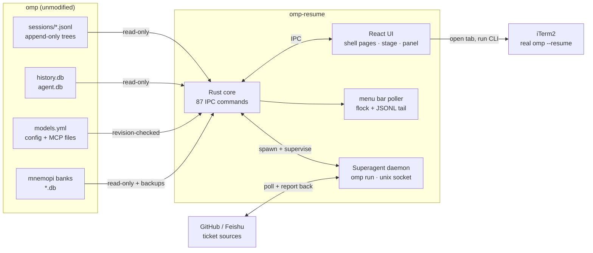

- **Sessions are never rewritten.** The only session-file mutation is a single `custom` line appended for a branch marker, which omp's context builder ignores by design.
- **In-use detection is a real `flock` probe** on omp's ownership lock, not a heuristic.
- **Config writes are validated** against a whitelist, use atomic temp-file + rename, and carry a revision so a concurrent edit surfaces as a conflict instead of being clobbered.
- **Memory deletion always backs up first.**
- Everything is local. No telemetry and no analytics; the only network calls are the updater, `omp update`, `omp bench`, the MCP handshake probe (system curl for http/sse, spawned stdio otherwise), the Superagent daemon's GitHub/Feishu traffic (only when you enable it), and the omp operations you explicitly trigger (plugins/marketplaces, skills update, skills discovery, model sandbox checks).

### Repo layout

```
src/                 React front end (81 test files, 731 tests)
src/stage/           Agent Stage: sprites, layout, scene, timeline
src/components/      Views: sessions, stage, config, tools, settings, superagent
src/ompCommands.ts   Cheat sheet: slash registry pinned to omp 19.1.1
src-tauri/src/       Rust core (523 tests, 87 IPC commands)
  sessions/          JSONL scan, tree building, conversation parsing
  stage/             Incremental cursors + actor state machine
  usage/             Per-session usage, redaction, caching
  memory/            Mnemopi bank reader + maintenance (delete/backup/restore)
  menubar/           Tray poller, classifier, notifications
  ops/               Delete, iTerm2, branch markers
  superagent/        Daemon supervisor: spawn, readiness, restart, proxy
superagent/          Orchestrator package: daemon + embeddable panel (1130 tests)
  src/app/           Runtime, settings, HTTP API
  src/core/          Engine
  src/omp/           omp --mode rpc sessions + plugin generation
  src/sources/       GitHub + Feishu watchers
  prompts/ skills/ plugin/  Bundled prompt pack, skill manuals, plugin template
docs/CONTRACT.md     Authoritative spec: formats, commands, semantics, error codes
docs/DECISIONS.md    Frozen D1–D13 log of measured evidence behind past choices
```

`docs/CONTRACT.md` is the source of truth: for any command, the contract, `model.rs`, `types.ts` and `api.ts` must agree, and the contract wins.

### Configuration

Everything is resolved from omp's own defaults; every path can be overridden for testing or for a non-standard omp install.

| What | Default | Override |
|---|---|---|
| Session directory | `~/.omp/agent/sessions` | `--sessions-dir <path>` or `OMP_RESUME_SESSIONS_DIR` |
| omp binary | first of `$HOME/.local/bin/omp`, `/opt/homebrew/bin/omp`, `/usr/local/bin/omp`, `$HOME/.bun/bin/omp` | `OMP_RESUME_OMP_BIN` |
| Ownership locks | `~/.omp/run/session-owners` | `OMP_RESUME_OWNERS_DIR` |
| Prompt history | `~/.omp/agent/history.db` | `OMP_RESUME_HISTORY_DB` |
| Daily model stats | `~/.omp/agent/agent.db` (`model_perf` table, read-only) | `OMP_RESUME_AGENT_DB` |
| Memory banks | `~/.omp/agent/memories/mnemopi/banks` | `OMP_RESUME_MEMORY_DIR` |
| Superagent state | `<app data>/superagent` (release) or `<app data>/superagent-dev` (debug) | `OMP_RESUME_SUPERAGENT_STATE_DIR` (absolute path); `OMP_RESUME_DATA_DIR` changes the parent |
| Superagent assets | bundled `Resources/superagent` (dev: `superagent/`) | `OMP_RESUME_SUPERAGENT_DIR` |
| App data (`meta.json`, `settings.json`, bench records, backups) | `~/Library/Application Support/omp-resume` | `OMP_RESUME_DATA_DIR` |

---

## Known limitations

- **macOS only.** The tray integration, iTerm2 automation and flock semantics are all macOS-specific.
- **Session format version 3 only.** Older sessions are listed but marked as unsupported.
- **Deletion is permanent** — no trash, no undo.
- **The Agent Stage polls** the JSONL every 1.5 s rather than subscribing to events, so it lags reality by up to ~2 s and cannot show background bash jobs or omp-internal queues.
- **Pins, hidden models and appearance prefs live in WebView localStorage**, so the dev build and the `.app` do not share them.
- **Superagent is local-first and unsupervised while enabled.** The daemon runs real omp sessions with yolo approvals inside its work directories; only enable it after reviewing the ticket sources and execution settings in the management panel.
- Detailed edge cases live in [docs/CONTRACT.md](docs/CONTRACT.md) and [docs/DECISIONS.md](docs/DECISIONS.md).
